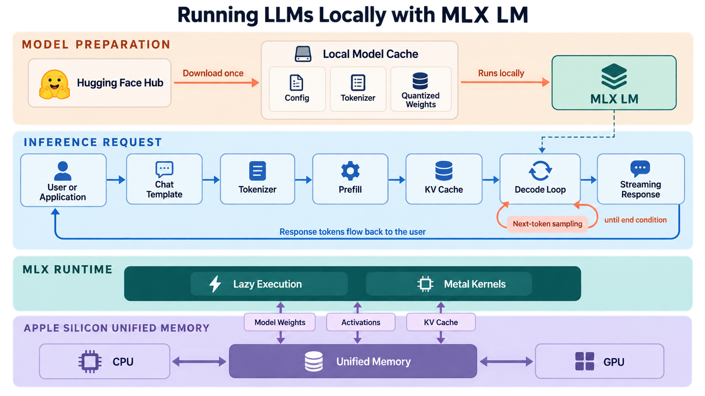

# Local LLMs with MLX

This is the supporting repository for the Local LLMs with MLX series in [The AIOps Newsletter](https://theaiops.substack.com/).

This repository provides a hands-on introduction to running large language models locally on Apple silicon with [MLX](https://github.com/ml-explore/mlx) and [MLX LM](https://github.com/ml-explore/mlx-lm). It covers a range of topics, from getting started with local inference to understanding and optimizing model performance.

MLX is an array framework designed for machine learning on Apple silicon. MLX LM builds on that foundation with tools for loading, generating, and serving large language models. Together, they make it possible to run capable language models locally on a Mac while taking advantage of its CPU, GPU, and unified-memory architecture.

The material in this repository connects hands-on examples with the underlying system behavior. It examines how models are obtained and loaded, how prompts become tokens, how prefill and autoregressive decoding produce a response, and how model configuration affects latency, throughput, and memory consumption. It also considers the practical concerns involved in turning a local experiment into a reusable application or service.

The focus is educational and measurement-driven. Examples are designed to make individual stages of inference visible, establish meaningful performance baselines, and help explain why a particular optimization changes speed, memory use, or output quality. Offline operation is also treated as an important capability: after the required model artifacts are downloaded, inference can remain on the local machine without sending prompts to a remote model provider.

## Tutorials

| Tutorial | Description | Tutorial | Code |
| --- | --- | --- | --- |
| **Why MLX for Local LLMs?** | Learn why MLX and MLX LM are a practical foundation for running language models locally on Apple silicon. The tutorial introduces their role in local inference and the advantages of Apple’s unified-memory architecture. | [Read the tutorial](https://theaiops.substack.com/p/why-mlx-for-local-llms) | — |
| **Getting started with MLX LM** | Set up an MLX LM project, download a small instruction-tuned model, and start a local server. Then send your first chat-completion request to verify the setup. | [Read the tutorial](https://theaiops.substack.com/p/getting-started-with-mlx-lm) | [Supporting code](tutorials/02-getting-started-with-mlx-lm/) |
| **Understanding local LLM models** | Learn what model names, variants, parameter counts, instruction tuning, quantization, and compatibility reveal before comparing repositories. | — | — |
| **Finding and managing models with Hugging Face** | Find MLX-compatible models on Hugging Face and inspect them before downloading. Learn to pin revisions, verify cached snapshots, work offline, and preview cache cleanup safely. | — | [Supporting code](tutorials/04-finding-and-managing-models-with-hugging-face/) |
| **Generating the first response** | Generate a response with the MLX LM CLI and Python API using a locally cached model. Follow the path from chat formatting and tokenization to streamed output, throughput, and memory metrics. | — | [Supporting code](tutorials/05-generating-the-first-response/) |
| **Sampling and reproducibility** | Compare the same prompt under greedy and sampled decoding profiles, then use a seed to make quality experiments easier to repeat. | — | [Supporting code](tutorials/06-sampling-and-reproducibility/) |

## License

This tutorial is licensed under the [Creative Commons Attribution-NonCommercial-ShareAlike 4.0 International License](LICENSE.md).
